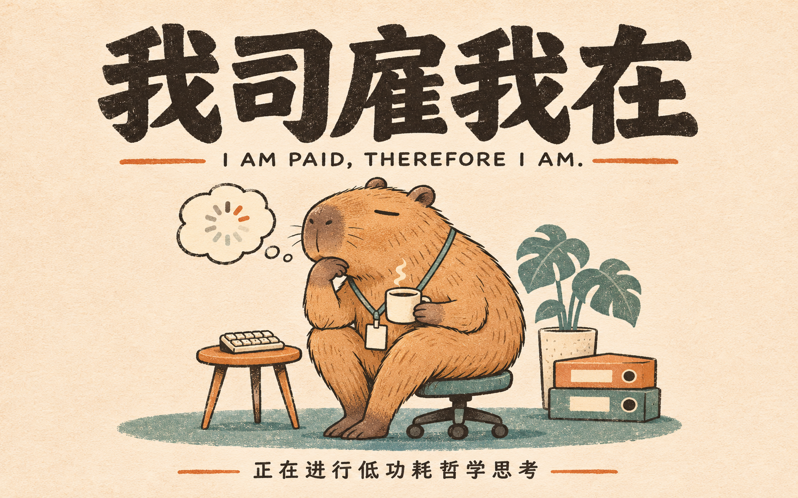
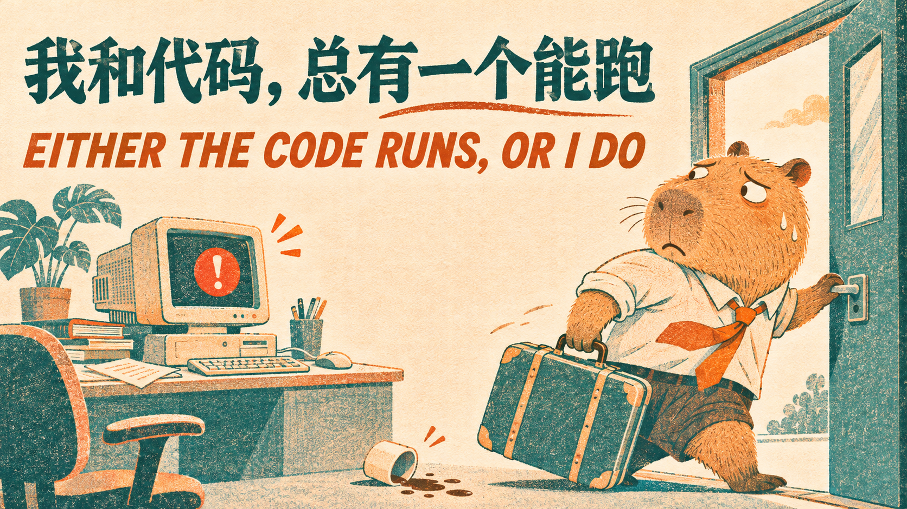

<div align="center">

# StillHere · 在场

**Step away. Your work stays.**  
**人可以离席，工作继续在场。**

A privacy wallpaper for macOS and Windows, made for people whose automation keeps working after they leave their desk.

[Download Beta](https://github.com/0xZoharHuang/stillhere-mac/releases/tag/v0.4.0) · [简体中文](README.zh-CN.md) · [Discuss](https://github.com/0xZoharHuang/stillhere-mac/discussions) · [Report a bug](https://github.com/0xZoharHuang/stillhere-mac/issues/new/choose)



</div>

## What is this?

You leave your desk. StillHere puts a wallpaper on the physical display while the desktop session underneath keeps running. On supported capture paths, the wallpaper is omitted from screen captures, so automation and remote-control tools can continue to see the desktop. It runs independently of any remote-control app.

**This is a visual privacy cover, not a lock screen.** Anyone at the computer who knows the shortcut can dismiss it, and the underlying session remains interactive. Capture and input compatibility depend on the OS and the tool: test your own workflow before relying on it.

- **One shortcut:** toggle privacy on and off without a password; no shortcut instructions on the wallpaper.
- **Wallpapers with personality:** a bilingual Chinese–English collection, plus your own image.
- **Works offline:** no account, server, or network connection is required by StillHere.
- **A compatibility gate:** the app checks capture behavior before enabling the full-screen cover; if the check fails, it stays off.

## Download and start

Get the [latest Beta packages](https://github.com/0xZoharHuang/stillhere-mac/releases/tag/v0.4.0). The app interface is currently **in Chinese**; both downloads include English and Chinese quick-start instructions.

| Platform | Package | Toggle shortcut |
| --- | --- | --- |
| macOS 14+ | `StillHere-0.4.0-mac-ready.dmg` — drag the app to Applications | **Control + Option + Command + P** |
| Windows 10 2004+ / .NET Framework 4.8 | `StillHere-0.2.0-windows-ready.zip` — extract all files, then open `StillHere.exe` | **Ctrl + Alt + Shift + P** |

On Mac, open **壁纸与设置** (Wallpaper & Settings) from the menu bar and select **壁纸库** (Wallpaper Library). On Windows, choose **选择壁纸** (Choose wallpaper) and select an image in the included `Wallpapers` folder. Both platforms also support your own image.

The macOS app is ad-hoc signed and not notarized, and the Windows executable is unsigned. Your OS may show an unknown-developer warning. Verify the source and checksums before deciding to run the app; see [Apple's guidance](https://support.apple.com/en-us/102445) for macOS.

## The wallpaper collection

The gallery combines workplace and AI-agent humor with 24 original illustrations. Each design has Chinese and English text. Mac includes the gallery in the app; the Windows download includes the same images in a folder.

| Context window full | Tested by prayer |
| --- | --- |
|  |  |
| More agents, less sleep | Either the code runs, or I do |
|  |  |

[Browse all 24 wallpapers](docs/WALLPAPERS.md) · [Artwork notes and inspiration](assets/wallpaper-gallery.md)

## Compatibility, honestly

The app does not lock the machine, stop sleep or lid-close behavior, or promise compatibility with every capture API. On macOS it uses a non-activating, mouse-transparent window and a system sharing flag; on Windows it uses `WDA_EXCLUDEFROMCAPTURE` and a non-activating, mouse-transparent window. Both implementations gate activation on a capture check.

The documented macOS 15.5 / Apple Silicon check exercised capture, clicks and typing under the cover. The Windows 10 19045 and Windows Server 2022 checks exercised a guarded native-input fixture. These are specific observations, not a guarantee for every version or remote app. A live UU Remote video-and-input journey for the current release has not been independently verified. See [verification](verification/README.md) for the precise scope.

## Build from source

```bash
# macOS: Xcode Command Line Tools and Swift 5.9+
swift test
bash scripts/build-app.sh --universal
bash scripts/package.sh
bash scripts/package-ready-mac.sh
```

For Windows build instructions, see [windows/README.md](windows/README.md). No credentials or personal profile are included in the release packages.

## Contributing

Tested on another OS version or remote tool? Found a wallpaper idea, a bug, or a better translation? [Open an issue](https://github.com/0xZoharHuang/stillhere-mac/issues/new/choose), [join the discussion](https://github.com/0xZoharHuang/stillhere-mac/discussions), or see [CONTRIBUTING.md](CONTRIBUTING.md).

[MIT License](LICENSE) · [中文说明](README.zh-CN.md)
